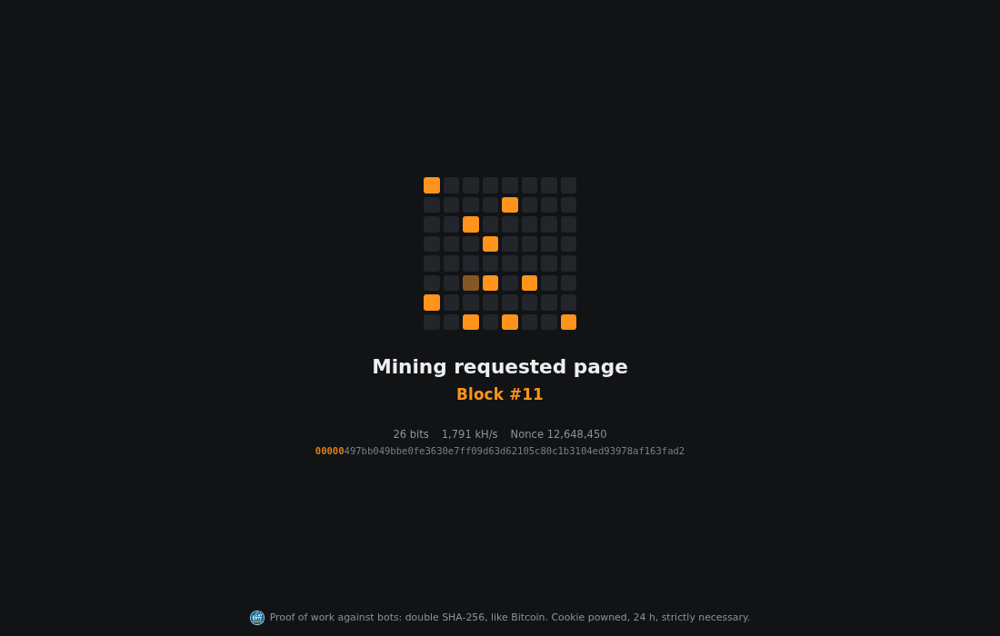
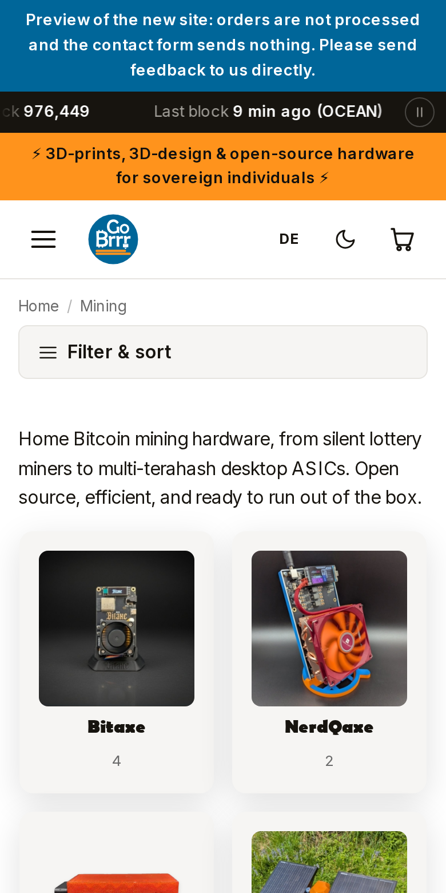

# Bots get PoWned

**PoWned** is a WordPress plugin that makes crawlers pay for what they take. Before a bot gets your expensive pages, it has to mine a block: double SHA-256 below a target, exactly like Bitcoin, just with a difficulty a phone solves in a blink. Humans wait about a second, once. Bots that hammer you from 10,000 rotating IPs pay again for every new network.

GG WP



## Why this exists

Our WooCommerce shop got farmed by a residential-proxy crawler. Tens of thousands of filter combinations (`?filter_pa_color=…&filter_pa_size=…`), about 10,000 IPs per half hour, one request each. Pages went from 0.3 to 25 seconds.

What did not work:

- **IP bans and rate limits.** Every IP shows up once. Nothing to ban.
- **User-agent filters.** It claims to be Chrome. Sure it is.
- **Hiding the links behind JavaScript.** It read our JavaScript and came back.

What works: make every request cost CPU time. Proof of work. The thing Bitcoin has been doing since 2009.

## Loadout

- **Real proof of work.** `SHA256(SHA256(challenge + nonce))` with a required number of leading zero bits. Same principle as a Bitcoin miner, same algorithm.
- **Difficulty adjustment.** Server busy? Difficulty goes up automatically: one extra bit at a set load per CPU core, one more each time the load doubles. Blocks already solved stay valid.
- **Bound to the network.** A solved block works for one /24 (IPv4) or /64 (IPv6) for 24 hours. Rotate your IP, mine again. Exact IP or no binding also available.
- **Stateless.** The challenge is signed (HMAC). The server stores nothing per visitor. The cookie holds challenge, nonce and signature plus a keyed hash of the network, never the IP.
- **Cheap to serve.** Optional early loader in `mu-plugins` checks before other plugins even load. The challenge page is a few kilobytes and answers in about 40 ms.
- **Multi-core mining.** One Web Worker per CPU core (up to 4), with a fallback for browsers without workers.
- **No third parties.** No CAPTCHAs, no external scripts, no fonts from elsewhere, no tracking. Runs under a strict Content-Security-Policy (no inline scripts or styles; needs `worker-src 'self'`).
- **Block counter.** The settings page shows how many blocks have been mined on your site. Every solved challenge counts once, and the visitor sees which block they are mining: *Block #1,337*.
- **Protected actions (optional).** Orders, coupon codes, logins, password reset requests, Contact Form 7 and comments each spend a block of their own: harder than a browsing block, valid 30 minutes, works once, and limited per network and hour. The browser mines it in the background on the pages where these actions happen, so humans never see a challenge page or a puzzle. Forms that are sent before the block is ready wait the fraction of a second it takes, then go out on their own. Details below.
- **Stealth mode (optional).** The challenge page shows a small spinner instead of the block, and only after 0.6 seconds. A quick solve looks like a normal page load.
- **Full lockdown (optional, for emergencies).** Every page view needs a solved block. Manual with an automatic switch-off, or automatic under heavy load. Read the warnings below before you use it.
- **30-day stats.** Blocks mined, average mining time, challenges shown, requests let through and the solve rate, with a small chart per day. Only daily totals are stored, nothing per visitor. Challenge counts ride on your object cache (Redis, Memcached) and are rolled up hourly, so a bot flood never turns into database writes.
- **Your look.** Accent color, logo (defaults to your site icon), own texts, light and dark mode. English and German built in, language by path prefix for multilingual sites.

## Installation

1. Download this repository as ZIP (*Code → Download ZIP*) or grab a release.
2. In WordPress: *Plugins → Add New → Upload Plugin*, pick the ZIP, activate.
3. Open *PoWned* in the admin menu. Check the protected parameters, set your accent color, hit *Preview the challenge page*.

The defaults protect WooCommerce filters out of the box (`filter_*`, `query_type_*`, `min_price`, `max_price`, `rating_filter`, `instock`, `on_sale`). Everything else is off until you switch it on. The admin area and the login page are never replaced by a challenge page. If you protect login forms and something goes wrong, `wp option patch update powned_settings guard_login 0` switches it off again.

Keep search engines away from filter URLs in your robots.txt (`Disallow: /*?*filter_`). They would only see the challenge page there anyway.

## Screenshots

| Mining (dark) | Mining (light, mobile) |
|---|---|
|  |  |

Settings: [screenshots/settings.png](screenshots/settings.png)

## Protected actions

Switch them on one by one under *Protected actions*:

| Action | What is checked | Where the browser mines |
|---|---|---|
| Checkout and express payment buttons | Classic checkout, Store API checkout (drafts and batch requests too). Opening the checkout without a block also shows the challenge page. | Cart, checkout, product pages, as soon as the page loads (express buttons live in iframes, clicks there cannot be seen) |
| Coupon codes | Refused before WooCommerce looks the code up, so guessing codes gets expensive | Cart and checkout |
| Login forms | `wp-login.php` and the WooCommerce account form. Without a block the password is not even checked, so bots cannot make your server compute password hashes. XML-RPC and application passwords are left alone. | Login page, account page, when someone starts typing |
| Contact Form 7, comments | A submission without a block counts as spam | Pages with a form, when someone starts using it |

Every action spends its own block. Placing a second order or sending a second form needs a second one; the browser mines it in the background. A typo at the checkout costs nothing, because the block is only spent when the order is created. Password reset requests and the "Pay for order" page are covered too. By default a network (/24 or /64) gets 10 actions of each kind per hour.

**Not covered:** coupons applied through links (WooCommerce checkout links, URL coupons of affiliate plugins), because those links are meant to work without any action. Logged-in users pass, so think twice if anyone can register on your site.

**Updating to 0.5:** clear your page cache, so pages load the new miner.

**Be realistic:** an action block (20 bits by default) takes seconds in a browser and far less in native code. It stops scripts that replay requests and makes bulk abuse expensive, but someone willing to mine can still act, up to the limit per network.

If a block expires during checkout (or the customer switches from Wi-Fi to mobile data), the order is refused once, the browser mines a new block and places the order again by itself.

Logged-in users always pass. Visitors without JavaScript cannot use protected actions.

**Payment providers are never touched.** PoWned does not keep a list of allowed gateways, which would never be complete. It only checks actions a person performs in a browser. Webhooks and callbacks (Stripe, Klarna, Mollie, BTCPay, PayPal and the hundreds of others) reach WordPress through `?wc-api=`, the REST API or Ajax and answer before PoWned looks at anything.

## Full lockdown

For when you are under heavy attack. Every page view needs a solved block, not just filters and checkout. Modes:

- **Log only:** blocks nothing, counts the pages that would have been challenged. Use this first to see whether anything you need would be caught.
- **On:** switches itself off after a set number of hours (6 by default).
- **Automatic:** switches on when the 5-minute load per CPU core stays above a threshold, and off again 15 minutes after it drops.

What stays open, whatever you run: payment webhooks and callbacks of any provider, the REST API, Ajax, feeds, sitemaps, `robots.txt`, the thank-you page, POST requests, explicit JSON or XML requests, logged-in users. Real search engine crawlers (Google, Bing, Apple, DuckDuckGo, Yandex) are let through when you keep that option on; they are verified by reverse DNS, so a bot that only claims to be Googlebot is not. You can also let through user agents of monitoring services or feeds you rely on.

While the lockdown is active, a red notice shows on every admin page, so nobody forgets it.

### Before you switch it on

- **Search engines and SEO.** Without the crawler exception, search engines only see the challenge page. It is sent as `503 Service Unavailable` with `Retry-After`, the correct signal for "temporarily down", so a few hours do no harm. Days can cost rankings or pages in the index.
- **Link previews.** Links shared in messengers and social networks show no title or image.
- **Price comparison sites, product feeds, marketplaces.** Google Merchant and similar services cannot fetch your product pages. Feeds may report errors and ads may be paused.
- **Uptime monitors** may report your site as down.
- **No JavaScript, no cookies, no entry.** Tor Browser on its safest level, some privacy extensions and some screen reader setups.
- **Old phones.** With a raised difficulty under load, mining can take several seconds and scare people away.
- **First page is slower** for every new visitor.
- **Page caches.** Pages your cache serves before WordPress loads are not checked. Cheap anyway, but not everything is "locked".
- **No silver bullet.** Bots that drive a real browser get slowed down and pay for every page, they are not stopped. Against network-level DDoS, PoWned does nothing; that is a job for your firewall or host.

## How it works

1. A request hits a protected parameter or path without a valid `powned` cookie.
2. The server sends the mining page with a signed challenge: `1.<expiry>.<client>.<bits>.<salt>.`
3. The browser grinds nonces until `SHA256(SHA256(challenge + nonce))` starts with enough zero bits, stores `challenge + nonce + "." + signature` in the cookie and reloads.
4. The server checks signature, expiry, network and the hash. Two SHA-256 runs and one HMAC, done.

Tuning: 18 bits is about 260,000 hashes on average, well under a second on current phones. Each extra bit doubles the work. The settings page shows the expected time for every level.

## Security notes

Thanks to [VirtusVerbis](https://github.com/gobrrrme/PoWned/issues/6) for the review and to [mptfire](https://github.com/mptfire) for the fixes in 0.4.2 (CSP on the challenge page, back link, multisite loader, proxy and cache warnings, write-free block counting). Found something? See [SECURITY.md](SECURITY.md).

- **Friction, not authentication.** Anyone who solves the proof of work can see the protected pages. PoWned makes bulk requests expensive, it does not decide who is allowed in.
- **Reverse proxy.** The block is bound to `REMOTE_ADDR`. If your own nginx, Apache or haproxy sits in front of WordPress, PoWned sees the proxy address, all visitors share one network and one solved block works for everyone. Return the real client address with the `powned_client_ip` filter, from a mu-plugin that loads before `powned-early.php` (for example `mu-plugins/00-powned-proxy.php`). Only read a forwarded header there if your proxy always sets it; without a proxy in front, anyone can send one.

  ```php
  <?php
  add_filter( 'powned_client_ip', function ( $ip ) {
      return $_SERVER['HTTP_X_REAL_IP'] ?? $ip; // set by your own proxy only
  } );
  ```
- **The secret.** Challenges and blocks are signed with a secret stored in the option `powned_secret`. Whoever has it (from a leaked backup or database copy) can create valid blocks without mining. *Rotate secret* on the settings page creates a new one; every visitor then mines once more.
- **Cookies.** The browser stores a freshly solved block in `powned_new`. On the next request the server takes it over as `powned`, an HttpOnly cookie that scripts on the page cannot read, and deletes `powned_new`. A stolen block only works from the same network (/24 or /64) until it expires.
- **Status codes.** The challenge page is sent with 403 by default, so caches and crawlers do not store it as content. 429 and 503 also work; the lockdown always uses 503 with `Retry-After`. 200 is possible but not recommended: some caches and crawlers would keep the challenge page as if it were your page.
- **Ad blockers.** Scripts and styles have neutral names (`pw-core.js`, `pw-ui.js`, `pw-bg.js`, `pw.css`). Cryptominer filter lists block files called `miner.js`. Security tools that watch CPU usage might still flag mining in rare cases.
- **Content-Security-Policy.** The challenge page sends its own strict CSP: scripts, styles and workers from your site only, no inline code, no outgoing connections. Plugin files served from a CDN or static domain, and a logo from elsewhere, are added automatically (with assets on another domain, browsers do not start workers, so mining runs on the page and takes a bit longer). Adjust it with the `powned_csp` filter.
- **Database writes.** With a persistent object cache (Redis, Memcached), solved blocks are counted in the cache and written to the database once an hour, so a flood of solved blocks causes no database writes.
- **Smaller points.** The signature is 64 bits of HMAC-SHA256 and can only be guessed online, one request per try. HEAD requests get no body. Texts from the `powned_strings` filter are escaped on output.

## Requirements

WordPress 6.2+, PHP 7.4+. The load-based difficulty reads `/proc/cpuinfo` and `sys_getloadavg()` (Linux). Without them, the base difficulty applies.

## Privacy

The cookie is strictly necessary for the security of the site and contains no personal data in clear text. Put a line in your privacy policy, for example:

> For an order, a form or another protected action, the result is kept for up to 30 minutes in the cookie `powned_action` and can be used once; to limit abuse, a keyed hash of your network is counted for up to two hours.
>
> When you use the shop filters, the checkout or a form, your browser solves a small computing task and stores the result for 24 hours in the cookie `powned` (right after solving briefly in `powned_new`, until the server takes it over). It protects the site against automated mass requests and contains no personal data.

## Roadmap

- **Honeypot links.** Invisible links that robots.txt forbids. Whoever follows them anyway gets a higher difficulty for their network.
- **Difficulty per area.** Checkout, coupons and login can cost more than browsing.
- **Pay per crawl.** Bots that want your data in bulk pay a few sats over Lightning (HTTP 402) instead of mining.

## License

GPL-2.0-or-later. Fork it, run it, PoWn some bots.

---

Built by [GoBrrr](https://www.gobrrr.me), your Bitcoin hardware shop from Austria. If PoWned saved your server, [buy us a coffee in sats](https://www.gobrrr.me/donate/).

> **Heads-up:** PoWned was vibecoded and has not seen a lot of real-world testing yet. Please [report any issues](https://github.com/gobrrrme/PoWned/issues) you run into, and feel free to contribute. Pull requests welcome.
